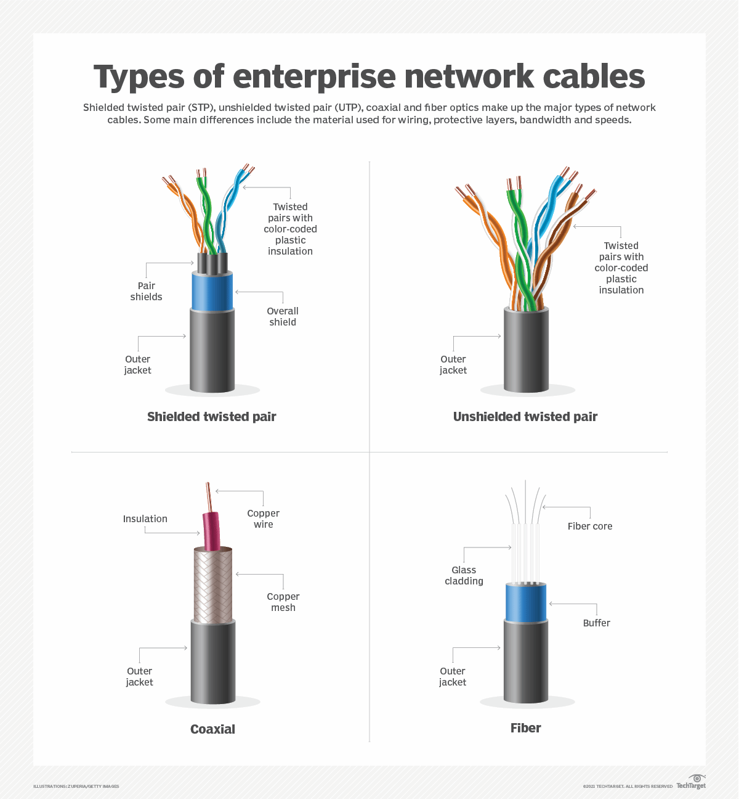

Wireless and Wired Cable Types – Computer Networking Notes
1. Introduction
In computer networking, communication media are used to connect computers and other network devices to transfer data.

There are two main types of transmission media:
1. Wired Transmission Media
2. Wireless Transmission Media
2. Wired Transmission Media
Wired transmission media use physical cables to transfer data between devices. These cables provide a connection between computers, switches, routers, and other network devices.
Types of Wired Cables
There are three main types of wired transmission media:
A. Twisted Pair Cable
Twisted pair cable consists of two insulated copper wires twisted together to reduce electromagnetic interference.

Types of Twisted Pair Cable:
1. UTP (Unshielded Twisted Pair)
   - Does not have additional shielding.
   - Commonly used in LAN networks.
   - Less expensive and easy to install.
   - Example: Ethernet cable.
2. STP (Shielded Twisted Pair)
   - Contains extra shielding to reduce interference.
   - Provides better protection against electromagnetic noise.
   - More expensive than UTP.
Uses:
- Local Area Networks (LAN).
- Telephone connections.
- Internet connections.
B. Coaxial Cable
Coaxial cable consists of a central copper conductor surrounded by insulation, metallic shielding, and an outer protective covering.

Features:
- Provides better protection against interference.
- Supports high-frequency signals.
- Strong and durable.
- Used for cable television and internet connections.
Uses:
- Cable TV.
- Broadband internet.
- CCTV systems.
C. Fiber Optic Cable
Fiber optic cable uses light signals to transmit data through thin strands of glass or plastic.

Features:
- Very high data transmission speed.
- Supports long-distance communication.
- Not affected by electromagnetic interference.
- More secure and reliable.
- Installation can be expensive.
Types of Fiber Optic Cable:
1. Single Mode Fiber (SMF)
   - Used for long-distance communication.
   - Carries light through a single optical path.
2. Multimode Fiber (MMF)
   - Used for shorter distances.
   - Carries light through multiple optical paths.
Uses:
- High-speed internet.
- Telecommunications.
- Data centers.
- Long-distance networks.
3. Wireless Transmission Media
Wireless transmission media transmit data without using physical cables. They use electromagnetic waves to communicate between devices.
Types of Wireless Transmission Media
A. Radio Waves
- Used for wireless communication.
- Can travel over long distances.
- Can pass through walls.
- Used in radio broadcasting and Wi-Fi.
B. Microwaves
- Use high-frequency electromagnetic waves.
- Usually require a clear line of sight.
- Used for long-distance communication.
- Used in satellite communication and mobile networks.
C. Infrared Waves
- Used for short-distance communication.
- Cannot pass through walls.
- Usually require a direct or nearby connection.
- Used in remote controls and some sensors.
D. Wi-Fi
- Allows devices to connect to a network wirelessly.
- Uses radio waves.
- Commonly used in homes, schools, offices, and public places.
E. Bluetooth
- Used for short-range wireless communication.
- Connects devices without cables.
- Commonly used in headphones, keyboards, speakers, and smartphones.
4. Difference Between Wired and Wireless Networks
Wired Network	Wireless Network
Uses physical cables.	Does not require physical cables.
Generally provides stable connections.	Connection may be affected by interference.
Usually offers better security at the physical connection level.	Requires proper wireless security.
Installation may require more effort.	Generally easier to install.
Devices have limited mobility.	Devices can move within network coverage.
Examples: Ethernet and Fiber Optic.	Examples: Wi-Fi and Bluetooth.

5. Advantages and Disadvantages
Advantages of Wired Networks
1. High-speed data transmission.
2. Stable and reliable connection.
3. Less wireless interference.
4. Better control over physical access.
Disadvantages of Wired Networks
1. Requires physical cables.
2. Installation can be expensive.
3. Limited mobility.
4. Cable damage can interrupt communication.
Advantages of Wireless Networks
1. No physical cables required.
2. Easy installation.
3. Supports mobility.
4. Convenient for multiple devices.
Disadvantages of Wireless Networks
1. Signal interference may occur.
2. Security risks if not properly configured.
3. Signal strength decreases with distance.
4. Speed and reliability may vary.
6. Conclusion
Wired and wireless transmission media are important parts of computer networking. Wired networks use physical cables such as twisted pair, coaxial, and fiber optic cables, while wireless networks use radio waves, microwaves, and infrared waves. Both technologies are widely used for communication and data transmission.

 
 